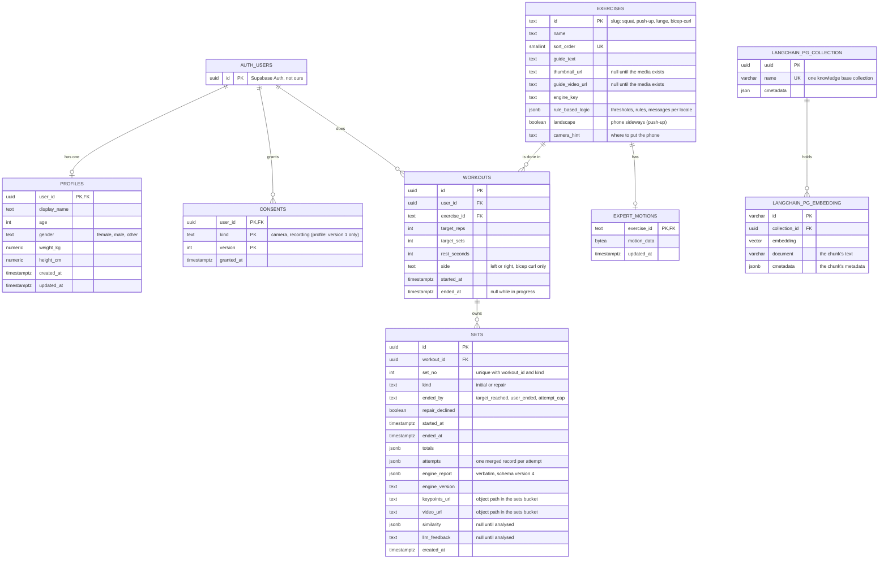

# Entity relationship diagram

How the data is stored, from `supabase/migrations/`. Mermaid: open the Markdown preview.

## What the diagram does not show

- Deleting a user cascades to their profile, consents, and workouts, and a workout cascades
  to its sets. `workouts.exercise_id` does not cascade.
- `sets.video_url` and `sets.keypoints_url` are not foreign keys. They are object paths,
  `<user_id>/<set_id>/video.webm` (or `.mp4`) and `<user_id>/<set_id>/keypoints.json.gz`, in
  the private `sets` storage bucket, whose policies allow a user only their own folder.
- Access is enforced by row-level security. `profiles`, `consents`, `workouts`, and `sets`
  are readable only by their owner (`sets` through its workout). `exercises` is read-only
  for signed-in users. `expert_motions` and the two `langchain_pg_*` tables have no app
  privilege at all; Punnapat's and Sujira's components write them directly.
- The knowledge base Sujira's feedback service retrieves from is langchain_postgres's own two
  tables, kept in its layout so the library uses them unchanged (2026-10-25). They are not
  linked to `exercises`; a chunk's exercise is in its metadata. Deleting a collection deletes
  its chunks.
- `public.knowledge_base`, made in September for this, was never used and is left out of the
  diagram. It is empty.
